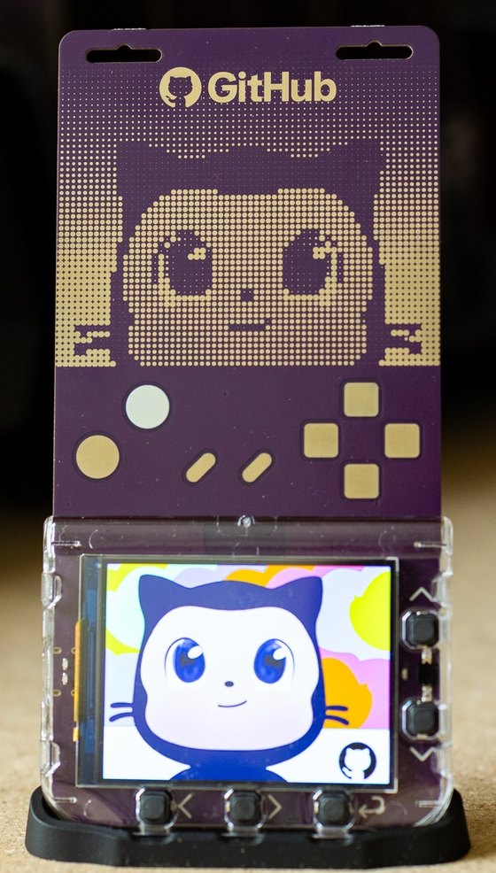
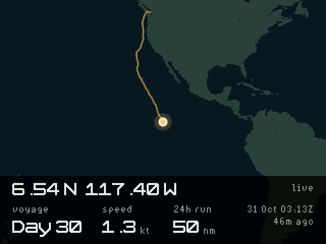
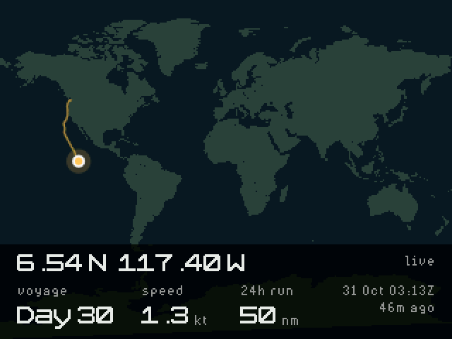

# Oliver for the GitHub Universe 2026 badge

A live world map for the **GitHub Universe 2026 badge (Badger 2350)**. It follows sailor Oliver Widger around the planet and shows where his boat is, how fast it's moving, and which day of the voyage he's on.

<p align="center">
  
</p>

<p align="center"><em>Photo cropped from the <a href="https://badger.github.io/">Badger 2026 Field Guide</a>.</em></p>

| Following the boat | The whole world |
| --- | --- |
|  |  |

*Captured from the badge's own frame buffer on 31 October 2026 UTC, Day 30 of the voyage.*

## Who is Oliver?

Oliver Widger is [@sailing_with_phoenix on Instagram](https://www.instagram.com/sailing_with_phoenix/), where about 2 million people follow the voyage. He sums up the story in one line: "I emptied my 401k, bought a sailboat, and left my 11-year corporate job to chase a dream: sailing around the world." He had never sailed when he bought a used Com-Pac 33, named it Phoenix after his rescue cat, and taught himself from YouTube videos. In 2025 he and the cat crossed from Oregon to Oahu in about 25 days, surviving a steering failure on the way ([Keel Index](https://keelindex.com/channels/sailing-with-phoenix)).

He then moved up to a 1998 Pacific Seacraft 40, *Phoenix do Mar* ("Phoenix of the Sea"), and refitted it in Port Townsend, Washington. On 2 October 2026 he left [Point Hudson](https://ptsail.org/2026/09/29/oliver-widger-circumnavigation-sendoff-friday-at-0700-10-2-2026/) on a solo, nonstop circumnavigation of about 30,000 miles, expected to take eight to nine months. Phoenix the cat stayed ashore this time, so *Phoenix* on the tracker means the boat.

This is a fan project. It isn't affiliated with Oliver, PredictWind, GitHub, or Pimoroni. The badge tells you where he is. [His Instagram](https://www.instagram.com/sailing_with_phoenix/) tells you why.

## What's on the screen

- **Position:** latitude and longitude of the latest fix
- **Status:** `live` from the tracker this run, `saved` from the last good reading, or `old: fetch failed`
- **Voyage:** Day 1 is 2 October 2026 UTC
- **Speed:** boat speed at the latest fix, in knots
- **24h run:** distance covered over the last 24 hours of fixes, in nautical miles
- **Last fix:** UTC time of the fix and how long ago it was

The amber line is his wake since departure. The badge clock is set from the tracker's reply, which means the age appears after the first successful fetch.

## Controls

| Button | Action |
| --- | --- |
| Left (`<`) | Show the whole world |
| Right (`>`) | Close in on the boat |
| Up / Down | Zoom in or out |
| Select (`↩`, bottom right) | Fetch again now |

Select gives no on-screen feedback beyond the fix time changing. The tracker itself only reports about hourly.

## How it works

The app fetches [Oliver's public PredictWind tracker](https://www.predictwind.com/tracking/SY_Phoenix) every 15 minutes. If that fails, it retries after a minute. The page is about 2.6 MB, far too big for the badge to parse, but the voyage sits at the very end. An HTTP range request asks for only the last 60 KB. The latest reading and the wake are saved to `/state/oliver.json`, which keeps the map working without a network.

Coastlines come from the world map that ships with the badge firmware.

## Requirements

- A GitHub Universe 2026 badge running the stock firmware. This is a custom derivative of Pimoroni's Tufty 2350 with an RP2350 and a 320x240 color LCD. Over USB it identifies itself as a Tufty 2350.
- Wi-Fi with internet access
- A USB data cable

Pimoroni's e-paper [Badger 2350](https://github.com/pimoroni/badger2350) is different hardware, and this app is not written for it.

Tested with MicroPython 1.29.0-preview firmware, built 2026-10-13.

## Install

Get the code:

```shell
git clone https://github.com/denmojo/badger-oliver.git
cd badger-oliver
```

### 1. Set your Wi-Fi

The simplest way is the badge's own **Settings** app. Otherwise, press RESET twice to enter disk mode and edit `secrets.py` at the top of the `BADGER` volume:

```python
WIFI_SSID = "your-network"
WIFI_PASSWORD = "your-password"
```

Keep the other lines as they are. If `REGION` is wrong for your country, change that too. The file lives only on your badge. Never commit a copy with your password in it; this repo ignores `secrets.py` in case you make one.

### 2. Add the app from the App Store page

The [badge App Store](https://badger.github.io/apps) can install a folder from your computer. It needs a current version of Chrome or Edge.

1. Connect the badge with a USB-C data cable.
2. Quickly press RESET twice on the back of the badge. A drive called `BADGER` appears.
3. On the App Store page, select **Open BADGER disk**. In this first dialog, choose the `BADGER` drive, not the `oliver` folder and not the drive's `apps` folder. Allow the browser to read and write its files.
4. Under **Add local app**, select **Choose an app folder**. In this second dialog, choose the `oliver` folder you cloned.
5. Select **Save** and wait for it to finish.
6. Select **Eject** on the page, then eject the drive in your file manager.
7. Press RESET once to return to the menu.

Choosing the wrong folder in step 3 gives the error "A requested file or directory could not be found."

To update an installed copy, delete `apps/oliver` from the `BADGER` drive first. The page won't replace an app that's already on the badge, and it can't remove one that isn't in its catalog.

### Alternative: copy the folder yourself

This is the route [documented by the badge project](https://github.com/badger/home/blob/main/hardware/USB_SERIAL.md):

1. Connect the badge and quickly press RESET twice. A volume called `BADGER` appears.
2. Copy the `oliver` folder into `apps/` on that volume.
3. Eject the volume and reset the badge.

On macOS:

```shell
cp -R oliver /Volumes/BADGER/apps/
diskutil eject /Volumes/BADGER
```

Oliver then appears in the menu. Stock menus may show a generic icon; the badge project's [menu icon patch](https://github.com/badger/home/blob/main/hardware/USB_SERIAL.md#menu-icon-patch) fixes that.

### Alternative: copy over serial

If disk mode gives you trouble, you can install over serial instead. `/system` is read-only over serial. These commands remount it as writable until the next reset. They write directly to the badge's flash and were tested only on the firmware above. The check on the first lines stops them if the filesystem isn't where it's expected. Back up anything you care about first.

```shell
pip install mpremote
mpremote devs
PORT=/dev/cu.usbmodem2101   # use the port from the line above

mpremote connect "$PORT" exec "
import rp2, vfs
flash = rp2.Flash(start=0, len=3072 * 4096)
boot = bytearray(4096)
flash.readblocks(0, boot)
assert boot[3:11] == b'MSDOS5.0'
vfs.umount('/system')
vfs.mount(vfs.VfsFat(flash), '/system')
" fs mkdir :/system/apps/oliver \
  + fs cp oliver/__init__.py :/system/apps/oliver/__init__.py \
  + fs cp oliver/icon.png :/system/apps/oliver/icon.png \
  + exec "import os; os.sync()"

mpremote connect "$PORT" reset
```

## Credits

Adapted from the ISS app in [badger/home](https://github.com/badger/home), which is MIT licensed. Boat data comes from Oliver's public [PredictWind tracker](https://www.predictwind.com/tracking/SY_Phoenix). If that page's layout changes, this app stops updating until it's fixed.

## License

MIT. See [LICENSE](LICENSE).
